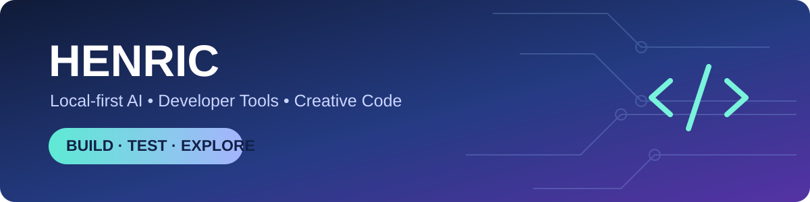

# Hi, I'm Henric 👋

**Local-first AI · Developer tools · Game tooling · Creative software**

[View repositories](https://github.com/HenricHuntsman?tab=repositories) · [Rabbit Code](https://github.com/HenricHuntsman/rabbit-foundry) · [QuestMaster-Pro](https://github.com/HenricHuntsman/QuestMaster-Pro)

I build and experiment with **local-first AI, developer tools, game tooling, and creative software**. My projects focus on practical workflows, reproducible testing, and learning by building.

> **Current focus:** reviving my development tools, improving Ollama-based coding workflows, and keeping experimental work separate from stable releases.

## 🕷️ HenricHuntsman

**Australian developer · Local-first AI · Open-source experimentation**

I'm building a practical toolkit around local AI, coding agents, game-development tools, and creative software. This profile highlights public work, preserved archives and research without claiming unfinished prototypes are production-ready.

**What I'm working on:** Rabbit Code, AgentFoundry, RepoForge, the DevTerminal revival, and separate mini-AGI research. I also develop World of Warcraft tooling and writing/publishing projects.

**Design direction:** real Australian huntsman wildlife photography, charcoal and forest-teal accents, readable GitHub Markdown, and authentic technology badges. The existing illustrated banner remains a placeholder until a licensed photograph is selected.

## 🧭 Explore my projects

Browse [all public repositories](https://github.com/HenricHuntsman?tab=repositories), or start with the projects below. The status labels describe development maturity, not a guarantee of successful installation.

**Status guide:** 🛠️ development · 🧪 prototype / experiment · 📚 reference or archive. These are editorial labels, not automated GitHub status reports.

## 🚀 Featured projects

| Project | What it does | Status |
| --- | --- | --- |
| [Rabbit Code](https://github.com/HenricHuntsman/rabbit-foundry) | Local-first Python coding agent and Ollama-compatible model gateway | Active development |
| [AgentFoundry Instantly](https://github.com/HenricHuntsman/AgentFoundry-instantly) | AI-assisted developer workspace and tooling | Development |
| [RepoForge](https://github.com/HenricHuntsman/repo-manager-ultimate) | Repository inventory, health checks and review tools | Development |
| [QuestMaster Pro](https://github.com/HenricHuntsman/QuestMaster-Pro) | World of Warcraft Lua addon and guide tooling | Development |
| [Book Publish Forge](https://github.com/HenricHuntsman/book-publish-forge) | Writing and publishing workflow tools | Development |
| [NebulaUltimate](https://github.com/HenricHuntsman/NebulaUltimate) | Experimental development platform and local AI skills | Prototype |
| [Trinity Studio Architecture](https://github.com/HenricHuntsman/Trinity-Studio-Architecture) | Architecture and tooling ideas for Trinity-related development | Reference / development |

## 📚 Other projects and preserved work

- [QuestMasterPro archive](https://github.com/HenricHuntsman/QuestMasterPro) — older addon bundles and project history; distinct from the active QuestMaster-Pro repository.
- [Azeroth Pilot Reloaded](https://github.com/HenricHuntsman/azeroth-pilot-reloaded) — addon code and upstream-tracking work.
- [LLM4Decompile](https://github.com/HenricHuntsman/LLM4Decompile) — model/decompilation research repository; check its upstream attribution and license.
- [4NXCI](https://github.com/HenricHuntsman/4NXCI) and [nxdumptool](https://github.com/HenricHuntsman/nxdumptool) — Nintendo Switch tooling repositories; follow applicable laws and project licenses.

## 🧪 AI and programming experiments

- [mini-AGI](https://github.com/HenricHuntsman/mini-AGI) — a **separate experimental research track**, not part of the FORGE codebase.
- [AgentFoundry TrinityCore Studio](https://github.com/HenricHuntsman/AgentFoundry-TrinityCore-Studio) — game-server development tooling experiments.
- [LisaAI Dating App](https://github.com/HenricHuntsman/LisaAI-DatingApp) — application development project.

### 🧰 Tech stack

These are real Shields.io badges using technology logos, not generated illustrations.

My local development workflow includes **Linux, Python, TypeScript, Node.js, Git, Ollama and CUDA-capable NVIDIA hardware**. I aim to test changes before merging and prefer tools that can work without mandatory cloud services.

## 💻 DevTerminal revival

**DevTerminal** is being revived in a **private** repository. Current priorities include verifying the Node.js build, Ollama integration, permissions and local-only behavior. Because the repository is private, no source link is provided here.

## 🔧 FORGE: work in progress

**FORGE** is my broader direction for local developer tooling. I am exploring how coding assistants, project management, model gateways, and desktop workflows can work together while remaining modular. It is a **development goal**, not a claim of a finished operating system or integrated release.

## 🌱 Upstream-tracking and reference repositories

I also maintain copies or experiments based on external codebases, including [Azeroth Pilot Reloaded](https://github.com/HenricHuntsman/azeroth-pilot-reloaded), [Codex](https://github.com/HenricHuntsman/codex), [Continue](https://github.com/HenricHuntsman/continue), [Gemini CLI](https://github.com/HenricHuntsman/gemini-cli), [Kimi K2](https://github.com/HenricHuntsman/Kimi-K2), [TrinityCore](https://github.com/HenricHuntsman/TrinityCore), and [nvm](https://github.com/HenricHuntsman/nvm).

These are not presented as entirely original projects; see each repository for upstream authorship, licenses, and contribution history.

## 🔗 Start here

- **[All public repositories](https://github.com/HenricHuntsman?tab=repositories)** — explore source code, experiments and references.
- **[Rabbit Code](https://github.com/HenricHuntsman/rabbit-foundry)** — local-first coding-agent development.
- **[QuestMaster-Pro](https://github.com/HenricHuntsman/QuestMaster-Pro)** — active WoW addon development.
- **[QuestMasterPro](https://github.com/HenricHuntsman/QuestMasterPro)** — separate historical archive.
- **[mini-AGI](https://github.com/HenricHuntsman/mini-AGI)** — independent AI research, not FORGE.

## ⏱️ Development hours & activity

**Hours logged:** Not yet tracked consistently. I don't publish an estimated lifetime total because Git commits and GitHub activity are **not** reliable measures of hours worked.

| Metric | Current state | How it will be measured |
| --- | --- | --- |
| Coding hours | Tracking setup pending | Opt-in local time log; publish monthly totals only |
| Project activity | [GitHub contributions](https://github.com/HenricHuntsman) | GitHub's native contribution calendar |
| Build health | Check each project | Actual CI workflows and test results, not decorative badges |
| Development progress | Milestones below | Verified checklist items, not guessed percentages |

**Local-first option:** [Developer-hours tracker](tools/dev-hours/README.md) records sessions in a private local CSV and generates a monthly report. No time logs are uploaded automatically; publishing a summary is a separate, opt-in step.

## 🛡️ Engineering principles

- **Privacy:** keep raw coding-time logs local; never publish private repository names or working directories by default.
- **Reproducibility:** document commands, environment and test evidence for each project.
- **Open-source credit:** distinguish original work from forks, mirrors and upstream-derived code.
- **Accessibility:** use meaningful link labels, readable text and alt text; never rely on a colour-only status.
- **Honest metrics:** only display measured hours, verified checks and explicitly defined milestones.

## 📊 Verified progress

**GitHub profile migration — 2 of 4 checked milestones (50%)**

`█████░░░░░ 50%` — *This is migration checklist completion, not coding progress or overall project completeness.*

- [x] GitHub username shows as **HenricHuntsman**
- [x] README draft links updated to the new account name
- [ ] Review and merge the README pull request
- [ ] Rename the profile README repository from `SpidermanTotro` to `HenricHuntsman`, then verify the public profile

**Project development:** In progress. Numeric completion percentages will be added only when each project has an agreed, measurable milestone list.

## 🧭 What comes next

| Area | Next verifiable milestone |
| --- | --- |
| Rabbit Code | Run and document a clean local test suite |
| DevTerminal | Reproduce build and permissions checks on Ubuntu |
| RepoForge | Validate repository audit results without destructive changes |
| mini-AGI | Preserve independent benchmarks and compare reproducibly |
| QuestMaster-Pro | Verify Lua addon packaging and checks |
| Profile design | Select and credit a genuine, reusable huntsman photo |

## 🗺️ Current roadmap

1. Reproduce builds and tests on Ubuntu before calling a project stable.
2. Strengthen local Ollama workflows, permissions, and failure handling.
3. Improve repository inventory and carefully resolve confusing names and duplicates.
4. Keep FORGE components modular; publish integrations only after they are validated.

## 🤝 How I work

- **Local-first where practical:** prefer on-device models and explicit network boundaries.
- **Test before release:** use linting, automated tests, build checks and small reproducible fixes.
- **Preserve history:** review duplicates and old experiments before archiving or deleting.
- **Keep projects distinct:** experiments, reference forks, and production-ready tools have different expectations.

---

*Profile migration note: GitHub account username is now HenricHuntsman, but the special profile README repository is still named SpidermanTotro. Rename that repository to HenricHuntsman after reviewing the migration checklist; no repository rename is performed by this README change.*

*Some projects are prototypes or undergoing revival. Links and status descriptions reflect the public repositories reviewed in October 2026; they do not guarantee a current passing build.*
