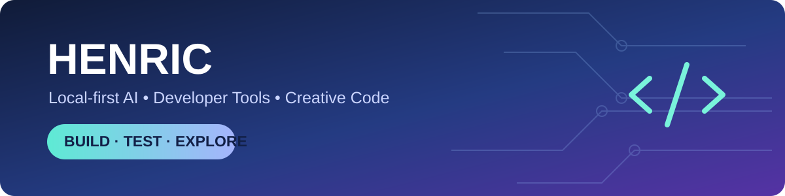

# Hi, I'm Henric 👋

**Australian developer · Local-first AI · Developer tools · Game tooling**

[**Open DragonHub**](https://repoforge-dashboard.vercel.app/dragonhub.html) · [Explore repositories](https://github.com/HenricHuntsman?tab=repositories) · [DragonForge Code](https://github.com/HenricHuntsman/dragonforge-code) · [OpenCode](https://github.com/HenricHuntsman/opencode) · [Rabbit Code](https://github.com/HenricHuntsman/rabbit-foundry) · [mini-AGI](https://github.com/HenricHuntsman/mini-AGI)

I learn by building, testing and improving practical software. My interests include local AI on Linux, terminal coding assistants, game tools and creative applications.

My current focus is **Seed Engine debugging, ARM64 tooling, local Ollama workflows, DragonForge Code and reproducible development**. Projects here range from experiments to maintained community forks; check each repository's documentation, tests and releases for its current state.

## Current focus — 19 November 2026

- **DragonHub diagnostics** — Nine Linux development diagnostics were added on 4 November. The milestone recorded 62 passing regression tests using local fixtures.
- **ARM64 and Linux tooling** — XenonRecomp’s read-only NSO0 metadata audit merged after nine synthetic tests passed in GitHub Actions. MacNativeGames’ Linux shader protocol checks passed. Its macOS settings-panel regression remains open. Stela’s translation and boot work is still in development.
- **Local coding tools** — DragonForge Code’s current default branch provides an Ubuntu launcher for OpenCode Revival with optional Ollama. OpenCode and Rabbit Code cover terminal coding and local model workflows.
- **Greenlight Recur** — Checkpoint and restart reliability remain the focus. Consumer-GPU resume validation and longer training runs remain open in the published assessment.

[19 November repository catch-up and CI evidence](docs/ACTIVITY-CHECK-2026-11-19.md) · [2 November activity snapshot](docs/ACTIVITY-CHECK-2026-11-02.md) · [19 October history](docs/ACTIVITY-CHECK-2026-10-19.md)

## Featured work

| Project | Focus |
| --- | --- |
| [FORGE Integration Lab / Kimi-K2](https://github.com/HenricHuntsman/Kimi-K2) | Python prototype with a local Ollama/Qwen adapter; live GPU and browser qualification pending |
| [DragonForge Code](https://github.com/HenricHuntsman/dragonforge-code) | Ubuntu Bash launcher for Go-based OpenCode Revival, with selectable workspaces and optional Ollama |
| [OpenCode — Welcome Back Edition](https://github.com/HenricHuntsman/opencode) | Community continuation of the original OpenCode terminal assistant, including local model endpoints and reusable skills |
| [Rabbit Code](https://github.com/HenricHuntsman/rabbit-foundry) | Local-first Python coding agent, model gateway and experimental Linux workspace |
| [Greenlight Recur / mini-AGI](https://github.com/HenricHuntsman/mini-AGI) | Experimental local AI training, checkpoint/resume reliability, evaluation and Training Doctor tooling |
| [Huntsman Repo Manager](https://github.com/HenricHuntsman/repo-manager-ultimate) | Repository inventory and review tools |
| [QuestMaster Pro](https://github.com/HenricHuntsman/QuestMaster-Pro) | World of Warcraft addon and guide tooling |
| [Book Publish Forge](https://github.com/HenricHuntsman/book-publish-forge) | Writing and publishing workflows |
| [AgentFoundry Workspace](https://github.com/HenricHuntsman/AgentFoundry-instantly) | Experimental developer workspace and application tooling |

## More to explore

- **Creative tools:** [Wordcraft](https://github.com/HenricHuntsman/wordcraft), [Artcraft](https://github.com/HenricHuntsman/artcraft), and [Nebula Ultimate](https://github.com/HenricHuntsman/NebulaUltimate).
- **Game development:** [Azeroth Pilot Reloaded](https://github.com/HenricHuntsman/azeroth-pilot-reloaded), [Trinity Studio Architecture](https://github.com/HenricHuntsman/Trinity-Studio-Architecture), and the separate [QuestMasterPro legacy collection](https://github.com/HenricHuntsman/QuestMasterPro).
- **Reverse-engineering research:** [REA](https://github.com/HenricHuntsman/rea) and [LLM4Decompile](https://github.com/HenricHuntsman/LLM4Decompile).
- **Upstream-derived work and references:** [Codex](https://github.com/HenricHuntsman/codex), [Continue](https://github.com/HenricHuntsman/continue), [Gemini CLI](https://github.com/HenricHuntsman/gemini-cli), [Kilo Code](https://github.com/HenricHuntsman/kilocode), and [TrinityCore](https://github.com/HenricHuntsman/TrinityCore).

Upstream authorship, notices and licences belong with each project. A repository on my account can contain upstream code, my changes, or preserved experiments.

## My development setup

Linux, Python, TypeScript, Node.js, Git, Ollama and NVIDIA GPU tooling are part of my workflow. I prefer on-device models and tools that can operate without mandatory cloud services.

## How I work

- Test changes and record what actually ran.
- Keep experimental research, stable work and historical archives distinct.
- Preserve checkpoints, history and upstream credit.
- Make tools readable, accessible and practical.
- Publish measured results; use each project's CI and releases for build status.

FORGE is my broader direction for modular local developer tooling. It remains work in progress.

## Recovery queue

[**Working tools, repairable prototypes, research, planning seeds and archives**](docs/RECOVERY-BOARD-2026-10-18.md) — each public project has a separate next milestone.

## Project catalogue

[**All project names, maturity and remaining work**](docs/PROJECT-CATALOGUE.md) · [Claims corrected](docs/CLAIMS-REVIEW-2026-10-18.md)

## Development status

[**Program maturity and build evidence — 1 November 2026**](docs/PROGRAM-MATURITY-2026-11-01.md)

OpenCode has a published development release. Rabbit Code, RepoForge, QuestMaster Pro and the Book Publish Forge desktop app are beta candidates for controlled testing. Other projects range from alpha research to planning and upstream references. These are review assessments; none is qualified as RC or RTM by this review.

## Repository guide

This profile repository holds the banner, documentation, a local [development-hours tracker](tools/dev-hours/README.md), and [preserved early prototypes](archive/README.md).

The 19 November catch-up covered **51 owned repositories**. The [public catalogue](docs/PROJECT-CATALOGUE.md) lists all **41 public repositories**. The [18 October audit](docs/REPOSITORY-AUDIT-2026-10-18.md) remains available as a historical record.

[Migration status](docs/HENRICHUNTSMAN-MIGRATION.md) · [Naming catalogue](docs/PROJECT-NAMING-CATALOGUE-2026-10-14.md) · [Live GitHub activity](https://github.com/HenricHuntsman)

Development hours are not yet published. Git commits are not a measure of time worked.

*Updated 19 November 2026 (Australia/Melbourne).*

[Linux projects: folders, preserved history and revival milestones](docs/linux/README.md).

[18 October repository catch-up: upstream gaps, update PRs and new findings](docs/REPOSITORY-CATCH-UP-2026-10-18.md).
